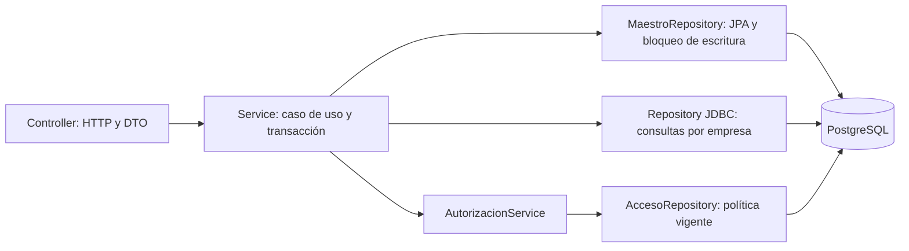

# Arquitectura y reutilización — etapas 2 y 3

Actualización de etapa 11: `gestion` incorpora un controlador de DTO explícitos,
dos servicios transaccionales y un repositorio JPA con consultas JDBC acotadas
para validación, series y auditoría. La cuenta de aplicación no necesita DDL.
No expone entidades ni modifica el JSON de consulta. Las versiones se comprueban
después del bloqueo compartido de administración; las pruebas ejercitan
concurrencia y rollback real. Véase [Gestión desde escritorio](GESTION_ESCRITORIO.md).
El texto siguiente conserva el inventario y decisiones de las etapas iniciales.

La API PostgreSQL conserva sus contratos de consulta. Esta etapa delimita las
capas. La etapa 3 añade la ficha de empresa y concesiones de visibilidad con
servicios JPA: [Empresas y maestros compartidos](EMPRESAS_Y_MAESTROS.md).

## Flujo que se ejecuta

Los diez módulos de `consulta` mantienen sus repositorios JDBC. Devuelven
proyecciones acotadas, agregan en SQL, filtran empresa y realizan paginación
en el servidor. Sustituirlos por navegación de entidades no aporta una mejora
demostrada y podría introducir N+1, carga de datos privados o cambios en JSON.
La relación de padres y permisos por fuente permanece en cada servicio.

`AutorizacionService.exigirLectura` centraliza la comprobación común y el 404
que evita enumeración. Cada servicio decide qué permisos necesita y conserva
su orden de comprobación. No se almacenan permisos en caché ni se sustituye
la política de ADMIN/SOCIO por nombres de usuario codificados en los módulos.
La consulta del permiso sigue accediendo a las asignaciones vigentes.

`EmpresaController` utiliza `EmpresaService`, que devuelve únicamente empresas
visibles para el usuario. `AuthController.me` utiliza `AuthService.perfil`.
Estas dos lecturas tienen transacciones de solo lectura. Los controladores ya
no inyectan repositorios. El listado de empresas pertenece aquí a la política
de acceso; `MaestroService.ficha` incorpora la ficha fiscal en etapa 3.

`common.Pagina<T>` contiene el contrato compartido, con los mismos campos JSON,
órdenes y valores de antes. Se trasladó desde `ConsultaDtos.Pagina` para que el
resto de módulos no dependa del contenedor de DTO de clientes/obras. Esto cambia
el nombre Java interno, no la API HTTP. No se mantiene una segunda clase equivalente.

Los paquetes vacíos `controller`, `service` y `repository` no representan capas
implementadas. No se llenan con CRUD genéricos ni se mueven todas las clases
solo para encajar en esas carpetas: los módulos operativos agrupan su flujo.

## Base JPA y futuros casos de gestión

Se conservan las 52 entidades iniciales y se añaden `Empresa`, `VinculoEmpleado`,
`AsignacionObra`, `Ausencia`, `ObservacionObra`, `FacturaGestion` y
`LineaFacturaGestion`, `VencimientoGestion`, `MovimientoTesoreria` y
`AplicacionTesoreria` (62 en total).
Hibernate valida sus mapeos PostgreSQL y las pruebas consultan el modelo.
Son una base aprovechable; no equivalen a 62 CRUD terminados.
La creación/modificación se incorporará al caso de uso de su etapa siguiendo:

1. El controlador recibe un DTO explícito y el usuario autenticado. No recibe
   entidades ni adopta autor, permisos o empresa efectiva de campos del cuerpo.
2. Un servicio transaccional comprueba permisos, pertenencia de todas las
   referencias y reglas de negocio. Las consultas ya existentes ayudan a
   contrastar la respuesta, pero sus filtros no garantizan integridad de escritura.
3. El repositorio JPA del agregado declara las operaciones necesarias y su
   ámbito. No se publican repositorios como REST ni se añade un servicio CRUD
   que permita `findById`/`deleteById` sin comprobar la empresa. `MaestroRepository`
   incorpora en etapa 3 las operaciones concretas de ficha y visibilidad.
4. El mapeo a respuesta es explícito, dentro de la transacción, con los campos
   permitidos. Las relaciones necesarias se cargan deliberadamente; LAZY por sí
   solo no demuestra ausencia de N+1. No se utiliza copia indiscriminada de propiedades.
5. Los importes, numeración, estado, autor y auditoría se derivan de las reglas
   del servidor cuando corresponde; no se confía en valores recibidos como resultado.

Antes de habilitar cada escritura se revisarán cascadas/orphan removal,
anulaciones, concurrencia y auditoría. No hay aún control global `@Version` ni
un servicio de auditoría empresarial. Tampoco se reinterpretan timestamps
históricos ni se cambia la representación decimal de la API por reutilizar
un DTO con `BigDecimal`. La escritura de observaciones requiere auditoría en
su propia etapa; no debe esperar al posterior trabajo de consolidación.

## Estado de los DTO

Revisión de limpieza del 26 de octubre de 2026: de los 155 DTO iniciales se
conservan tres, utilizados por pruebas existentes: `CobroCreateDTO`,
`UsuarioCreateDTO` y `UsuarioUpdateDTO`. Los dos últimos comprueban que las
contraseñas no se exponen al serializar ni en `toString`; el primero comprueba
validaciones de cobros. Ninguno es un contrato REST publicado.

Se han retirado los otros 152 borradores tras comprobar sus referencias en
controladores, servicios, repositorios, recursos, scripts, pruebas y OpenAPI.
Las referencias entre borradores forman un conjunto desconectado de los tipos
conservados. No tienen anotaciones de componentes Spring, entidades JPA ni
registro dinámico en el servidor. La exploración por reflexión de
`ArquitecturaTests` sigue comprobando los DTO que permanecen, sin cambiar la
prueba ni reducir las comprobaciones de los contratos REST.

Los DTO operativos de cada módulo, `security/AuthDtos`, `common.Pagina` y los
errores comunes se conservan íntegros. El contrato HTTP mantiene sus 193
operaciones y 177 esquemas, versión `0.20.5-candidato`. La compatibilidad
comprobada es la de esa API; no se han inspeccionado proyectos de clientes
Android o escritorio externos a esta carpeta.

[Inventario actual](INVENTARIO_DTO.json), reproducible con
`node scripts/inventariar-arquitectura.mjs`, contiene los tres DTO restantes.
Las similitudes entre campos de DTO de recursos distintos no se consideran
por sí solas una justificación para unificar contratos.
## Comprobaciones automáticas

`ArquitecturaTests` inspecciona los controladores registrados por Spring, sus
dependencias inyectadas y los tipos REST, incluidos campos de DTO y argumentos
genéricos. Rechaza entidades/componentes en respuestas y cuerpos, contratos
opacos `Object` y repositorios inyectados en controladores. También comprueba
los DTO iniciales. Una regresión demuestra la detección de una entidad escondida
tras lista/página y de una respuesta opaca. Esto no sustituye las pruebas de
autorización, serialización ni la revisión de lógica dentro de los métodos.

`OpenApiTests` compara el contrato con el registro real de Spring, sin lista fija
de controladores y para todos los verbos HTTP declarados. Así una futura ruta
PUT/PATCH/DELETE no quedará fuera de la comparación. Conserva las otras cinco
comprobaciones del contrato. El contrato actual es `0.20.5-candidato`, con 193 operaciones.

La gestión de usuarios incorpora `GestionUsuariosService` y un repositorio con
JPA para Usuario y SQL explícito para asignaciones/catálogos/auditoría, dentro de
una única transacción. Los cambios administrativos se serializan para proteger
el último administrador; login, refresh y gestión bloquean usuario antes de
sesión. Política y límites en [Usuarios y permisos](USUARIOS_Y_PERMISOS.md).

`EmpleoService` delimita la gestión de vínculos, asignaciones y ausencias. Las
tres entidades nuevas se escriben mediante JPA; las proyecciones, conteos,
auditoría y bloqueos usan SQL explícito en la misma transacción. Comparten el
bloqueo administrativo y revalidan permisos. Los nuevos DTO operativos omiten
importes y textos libres; no se reutiliza el detalle general de obra para el
trabajador. Véase [Empleados, obras y ausencias](EMPLEADOS_OBRAS_AUSENCIAS.md).

`ObservacionObra` es un agregado propio, distinto de las incidencias históricas.
`ObservacionService` conserva autor, instantes UTC y resolución; escribe mediante
JPA y audita mediante SQL en la misma transacción. Reutiliza la comprobación de
obra asignada y el bloqueo administrativo para revalidar el acceso tras esperar.
Los listados omiten textos y el detalle operativo no incorpora datos económicos.
Reglas y contrato en [Observaciones de obra](OBSERVACIONES_OBRA.md).

`FacturaGestion` prepara el documento y conserva su trazabilidad; sus líneas
guardan los resultados exactos del cálculo. `EmisionRepository` materializa
una sola vez `FacturaCliente`/`FacturaProveedor` y sus líneas existentes. Se
conserva así el contrato de consulta e informes. `FacturacionService` comparte
el bloqueo administrativo, revalida permisos y bloquea la serie al asignar
número. Contador, documento, factura y auditoría comparten transacción.
Véase [Facturación](FACTURACION.md).

La suite de integración existente sigue verificando pertenencias, permisos,
revocación, concurrencia de refresh, filtros, saldos y representación JSON sobre
PostgreSQL real. El cierre y evidencias de esta etapa se registran en
la documentación histórica archivada localmente.
